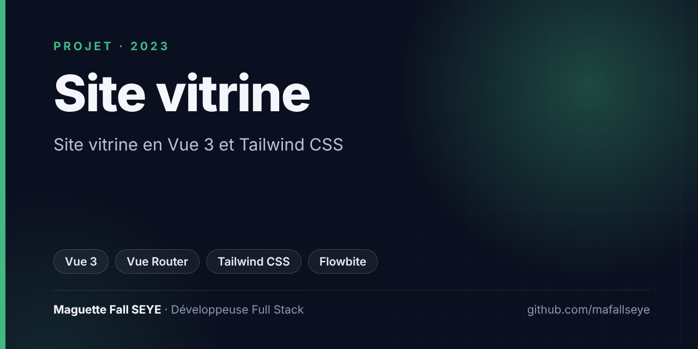

<p align="center"></p>

# Site vitrine

Site vitrine.

## Fonctionnalités

- Pages Accueil et À propos
- Composants Flowbite

## Technologies

Vue 3 · Vue Router · Tailwind CSS · Flowbite

## Lancer le projet

Prérequis : Node.js 16 ou plus.

```bash
git clone https://github.com/mafallseye/sitemodou.git
cd sitemodou
npm install
npm run serve
```

> Projet réalisé en 2023 pendant ma formation. Il est conservé ici comme trace de mon parcours.

## Auteure

**Maguette Fall SEYE** — Développeuse Full Stack, Dakar (Sénégal) · [github.com/mafallseye](https://github.com/mafallseye)
